<div align="center">

# GDG on Campus · Info Session

**[🇹🇷 Türkçe (Varsayılan)](#-gdg-on-campus--info-session--masa-eşleştirme-uygulaması)** · **[🇬🇧 English](#-gdg-on-campus--info-session--table-matching-web-app)**

</div>

---

<a id="türkçe"></a>

# 🇹🇷 GDG on Campus · Info Session — Masa Eşleştirme Uygulaması

Bu proje, **GDG on Campus** topluluğunun bir kafede gerçekleştirdiği tanışma etkinliği (**Info Session**) için geliştirilmiş, **Türkçe ve İngilizce (`TR` / `EN`)** çift dil destekli, mobil öncelikli bir masa eşleştirme web uygulamasıdır. Katılımcılar telefonlarından 8 kısa soruluk anketi (1–2 dakika) yanıtlar; sistem verilen cevaplara göre katılımcıları hem ortak ilgi alanlarına sahip hem de çeşitlilik açısından dengeli masalara otomatik olarak yerleştirir. Organizatörler ise masaüstü **Admin Paneli** ve tam ekran **Projektör Görünümü** üzerinden etkinliği canlı olarak yönetir.

Hem **Google / Material Design 3** tasarım diline sahip modern bir kullanıcı arayüzü (Frontend) hem de **Neon Postgres** tabanlı bir API (Backend) içerir. Canlı sürüm **Vercel + Neon** üzerinde çalışır.

---

## Canlı Yayın & Hızlı Erişim

Uygulama Vercel üzerinde aktiftir. Aşağıdaki bağlantılara tıklayarak veya QR kodları telefonunuzun kamerasıyla okutarak hemen deneyebilirsiniz:

| Katılımcı Uygulaması (Masanı Bul) | Yönetici Paneli (Admin) |
| :---: | :---: |
| [](https://info-session-psi.vercel.app/) | [](https://info-session-psi.vercel.app/admin) |
| **[Info Session · Masanı Bul](https://info-session-psi.vercel.app/)** | **[Admin · Info Session](https://info-session-psi.vercel.app/admin)** |
| *Katılımcıların 8 soruluk anketi doldurup masasını öğrendiği mobil ekran* | *Masa dağılımları, canlı doluluk, kişi taşıma/silme ve projektör görünümü* |

---

## İçindekiler
1. [Canlı Yayın & Hızlı Erişim](#canlı-yayın--hızlı-erişim)
2. [Ekran Görüntüleri](#ekran-görüntüleri)
3. [Tasarım Dili (Google / Material Design 3)](#tasarım-dili-google--material-design-3)
4. [Kullanılan Teknolojiler](#kullanılan-teknolojiler)
5. [Özellikler ve Şu Anki Durum](#özellikler-ve-şu-anki-durum)
6. [Proje Yapısı](#proje-yapısı)
7. [Yerel Kurulum ve Çalıştırma](#yerel-kurulum-ve-çalıştırma)
8. [Ortam Değişkenleri (.env)](#ortam-değişkenleri-env)
9. [Eşleştirme Algoritması ve Etkinlik Akışı](#eşleştirme-algoritması-ve-etkinlik-akışı)
10. [Canlıya Alma Rehberi (Deployment)](#canlıya-alma-rehberi-deployment)

---

## Ekran Görüntüleri

### 1. Katılımcı Akışı (Mobil — Açık Tema)
| 1. Karşılama | 2. İsim & Gizlilik | 3. Derecelendirme (1–5) | 4. Tekli Seçim | 5. Çoklu Seçim |
| :---: | :---: | :---: | :---: | :---: |
| 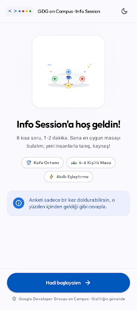 | 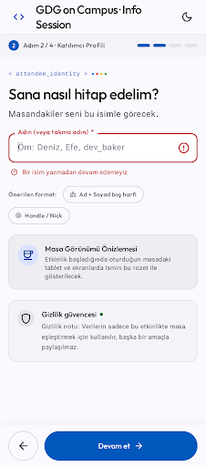 | 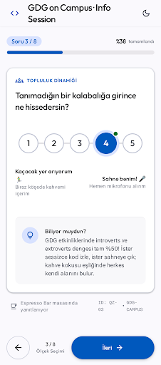 | 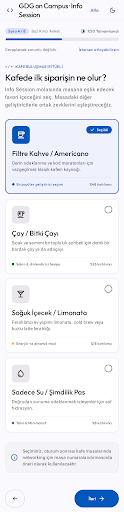 | 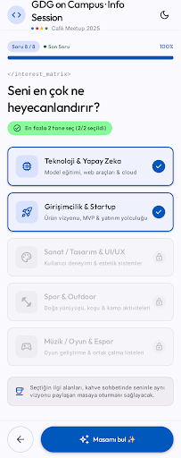 |

### 2. Sonuç ve Bağlantı Durumu Ekranları
| 6. Masaya Yerleşti (Masa 4) | 7. Dağıtım Bekleniyor | 8. Bekleme Listesi | 9. Çevrimdışı & Hata Durumu |
| :---: | :---: | :---: | :---: |
| 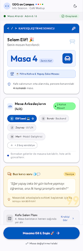 | 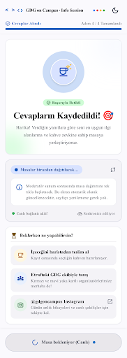 | 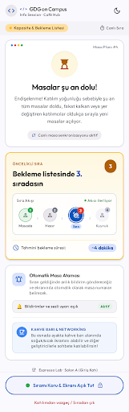 | 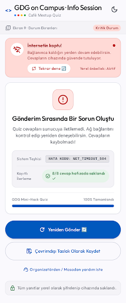 |

### 3. Koyu Tema (Dark Mode) Görünümleri
| Karşılama (Koyu Tema) | Tekli Seçim (Koyu Tema) | Masaya Yerleşti (Koyu Tema) |
| :---: | :---: | :---: |
| 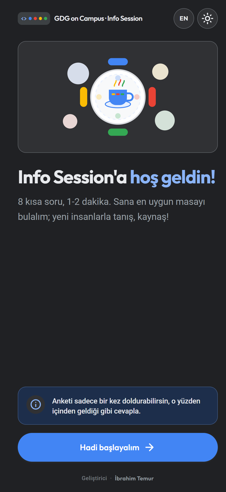 | 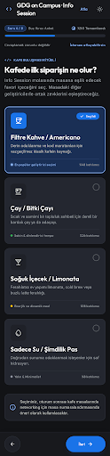 | 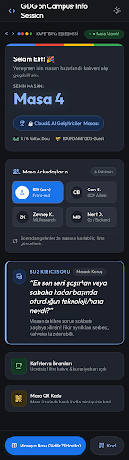 |

### 4. Organizatör Admin Paneli & Projektör Görünümü
| 11. Admin Paneli — Masa Yönetimi (1440×900) | 13. Canlı Projektör Görünümü (1920×1080 Koyu Tema) |
| :---: | :---: |
| 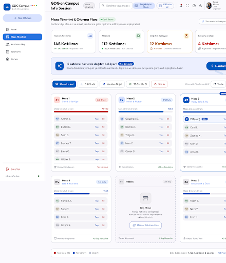 | 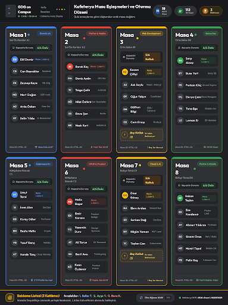 |

| 10. Admin Girişi | 12. Katılımcıyı Taşı & Sıfırla Onay Modalları |
| :---: | :---: |
| 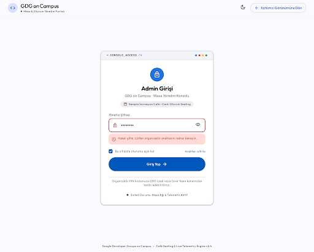 | 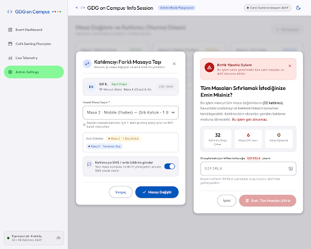 |

---

## Tasarım Dili (Google / Material Design 3)

Arayüz, resmi bir **GDG on Campus** ürünü hissiyatı verecek şekilde **Material Design 3** standartlarıyla tasarlanmıştır:

- **Google 4-Renk Paleti:**
  - **Birincil Aksiyon:** Google Mavi `#4285F4` (basılı `#1A73E8`)
  - **Vurgu Renkleri:** Kırmızı `#EA4335`, Sarı `#FBBC04`, Yeşil `#34A853`
  - **Tonal Kapsayıcılar:** Mavi `#E8F0FE`, Yeşil `#E6F4EA`, Sarı `#FEF7E0`, Kırmızı `#FCE8E6`
  - **Düz Yüzeyler (Flat Surfaces):** Açık temada `#F8F9FA` arka plan / `#FFFFFF` kart yüzeyi (`#DADCE0` kenarlık); koyu temada `#202124` arka plan / `#303134` kart yüzeyi.
- **Tipografi ve İkonografi:**
  - Başlıklar: **Google Sans** (`Outfit` yedekli), Gövde: **Roboto**
  - Tüm ikonlar emoji yerine renkli tonal daireler içinde **Material Symbols Rounded** kullanılarak oluşturulmuştur.
  - Üst barda `< >` kod braketi ve dört Google rengi nokta ile `"GDG on Campus · Info Session"` marka imzası, sağda ise **`EN` / `TR`** dil değiştirici ve açık/koyu tema anahtarı yer alır.
- **Masa Renk Kimliği (`tableNumber mod 4`):**
  - Her masa numarası dört Google renginden biriyle eşleşir (`Masa 1` Kırmızı, `Masa 2` Sarı, `Masa 3` Yeşil, `Masa 4` Mavi vb.) ve bu renk katılımcı sonuç kartında, admin masa kartlarında ve 1920×1080 projektör ekranında tutarlı şekilde kullanılır.

---

## Kullanılan Teknolojiler

| Bölüm | Teknoloji | Açıklama |
|---|---|---|
| **Frontend** | React (v19) + Vite (v8) | Mobil öncelikli, hızlı arayüz kütüphanesi. |
| **Stil / UI** | Tailwind CSS (v4) + Framer Motion + Material Symbols Rounded | Google Material Design 3 bileşenleri ve akıcı geçiş animasyonları. |
| **Çoklu Dil (i18n)** | React Context (`src/lib/i18n.jsx`) | Tüm arayüz, sorular, masa temaları ve buz kırıcı sorular için anlık Türkçe / İngilizce (`TR` / `EN`) dil desteği. |
| **Backend** | Node.js + Express (v5) | REST API; Vercel serverless fonksiyonu olarak çalışır. |
| **Veritabanı** | Neon Postgres (`pg`) | Serverless uyumlu, kalıcı Postgres. Yerleştirme işlemleri advisory lock ile sıraya alınır. |
| **Doğrulama (Validation)** | Zod | Gelen isteklerin yapısal bütünlüğünü doğrulamak için. |
| **Test** | Vitest + Supertest + PGlite | Frontend algoritma/admin/i18n birim testleri ve süreç içi Postgres ile backend API entegrasyon testleri (45 test). |
| **Barındırma** | Vercel + Neon | Frontend + API tek projede, veritabanı Neon Frankfurt (`fra1`). |

---

## Özellikler ve Şu Anki Durum

| Özellik | Durum |
|---------|-------|
| **GDG on Campus Material 3 UI** | Tamamlandı (Açık/koyu tema, AA kontrast, 48px+ dokunma hedefleri, 56px hap butonlar) |
| **Çift Dil Desteği (`TR` / `EN`)** | Tamamlandı (Varsayılan Türkçe; tüm ekranlar, 8 soru, masa temaları, buz kırıcı sorular ve hata mesajları tek tıkla İngilizceye geçer) |
| **Anket ve Eşleştirme Mantığı** | Tamamlandı (8 soru: derecelendirme ölçeği, tekli seçim, çoklu seçim, opsiyonel soru atlama) |
| **Sonuç Ekranları** | Tamamlandı (Masaya yerleşenler için masa renginde hero kart + buz kırıcı soru, havuzda bekleyenler için otomatik güncellenen ekran, bekleme listesi sırası) |
| **Backend ve Veritabanı** | Tamamlandı (Express + Neon Postgres, transaction + advisory lock) |
| **Admin Paneli & Projektör Görünümü** | Tamamlandı (4 özet istatistik kartı, havuz dağıtım banner'ı, CSV indirme, 30 kişilik simülasyon, kişi taşıma/silme modal pencereleri ve `#202124` koyu tema canlı Projektör ekranı) |
| **Otomatik Testler** | Tamamlandı (Frontend ve Backend toplam 45 test geçiyor) |

---

## Proje Yapısı

Proje Frontend (`src/`), Vercel fonksiyon girişi (`api/`) ve Backend kodu (`backend/`) olarak yapılandırılmıştır. Tüm bağımlılıklar kökteki tek `package.json` içindedir:

```text
info-session/
├── README.md                        # Projenin Türkçe & İngilizce ana dokümantasyonu
├── API_CONTRACT.md                  # Frontend ve Backend arasındaki iletişim kuralları
├── package.json                     # Tüm bağımlılıklar ve scriptler (frontend + backend)
├── vite.config.js                   # Vite ayarları, test ayarları ve yerel API proxy'si
├── vercel.json                      # Vercel yönlendirmeleri ve fonksiyon bölgesi (fra1)
├── index.html                       # Google Fonts (Outfit, Roboto, Material Symbols Rounded) ve kök HTML
├── api/
│   └── index.js                     # Vercel serverless giriş noktası (Express uygulamasını dışa aktarır)
├── docs/
│   ├── qr/                          # README için QR kod görselleri (qr-app.png, qr-admin.png)
│   └── screens/                     # Uygulama ekran görüntüleri (01-welcome..13-projector-view.png)
├── public/
│   └── qr/                          # Statik sunulan QR kod görselleri
├── scripts/
│   └── seed.mjs                     # Hızlı test verisi üretme betiği
├── src/                             # Frontend Kodları
│   ├── App.jsx                      # Katılımcı akışı ve /admin yönlendirmesi
│   ├── index.css                    # Material Design 3 renk token'ları ve bileşen sınıfları
│   ├── main.jsx                     # React uygulama girişi (I18nProvider ile sarılı)
│   ├── api/                         # Backend iletişimi (client.js, errors.js, mockServer.js)
│   ├── components/                  # Yeniden kullanılabilir M3 bileşenleri
│   │   ├── Icon.jsx                 # Material Symbols Rounded, TonalIcon, GdgBrandMark, getTablePalette
│   │   ├── OfflineBanner.jsx        # Çevrimdışı uyarı bandı
│   │   ├── OptionCard.jsx           # İkonlu tekli/çoklu seçenek kartı
│   │   ├── ProgressBar.jsx          # Anket ilerleme çubuğu ("Soru 3 / 8" ve "%38")
│   │   ├── QuestionCard.jsx         # Soru başlığı ve girdi kapsayıcısı
│   │   ├── SliderQuestion.jsx       # 5 adımlı dairesel derecelendirme ölçeği
│   │   ├── ThemeToggle.jsx          # Açık/koyu tema değiştirici
│   │   └── admin/                   # Admin bileşenleri (LoginForm, TableCard, MoveDialog, ConfirmDialog, Modal, ProjectorView, ui.js)
│   ├── lib/                         # Eşleştirme (matching.js), sorular (questions.js), dil (i18n.jsx), CSV ve testler
│   └── pages/                       # Sayfalar (Welcome, Name, Quiz, Result, Admin)
└── backend/                         # Backend Kodları
    ├── .env.example                 # Backend için örnek ortam değişkenleri
    ├── scripts/
    │   └── seed.js                  # Backend veritabanı tohumlama betiği
    ├── src/
    │   ├── server.js                # Express uygulaması
    │   ├── db.js                    # Postgres bağlantısı (pg / testte PGlite)
    │   ├── middleware/              # Admin yetki doğrulaması (adminAuth.js)
    │   ├── routes/                  # API uç noktaları (admin.js, participants.js, tables.js)
    │   ├── services/                # İş mantığı (placement.js)
    │   └── shared/                  # Paylaşılan eşleştirme modülü (matching.js)
    └── tests/                       # Backend API entegrasyon testleri (api.test.js)
```

---

## Yerel Kurulum ve Çalıştırma

Projeyi bilgisayarınızda çalıştırmak için Node.js (v20+) kurulu olmalıdır. Backend ve frontend **tek bir `package.json`** kullanır.

### 1. Bağımlılıkları kurun
Kök dizinde:
```bash
npm install
```

### 2. Backend'i başlatın
API için bir Postgres veritabanı gerekir (örn. ücretsiz bir Neon veritabanı). `backend/.env` dosyasına `DATABASE_URL` ve `ADMIN_PASSWORD` yazın, sonra:
```bash
npm run dev:api
```
*(API varsayılan olarak `http://localhost:3000` portunda çalışır. Tablo ilk istekte otomatik oluşturulur.)*

### 3. Frontend'i başlatın
Farklı bir terminalde:
```bash
npm run dev
```
*(Frontend `http://localhost:5173` portunda açılır ve `/api` isteklerini otomatik olarak 3000 portuna yönlendirir.)*

### 4. Diğer Yararlı Komutlar (Kök Dizinde)
- `npm test`: Frontend ve backend (API) testlerini çalıştırır. Backend testleri gerçek veritabanı gerektirmez; süreç içi Postgres (PGlite) kullanır.
- `npm run seed`: Rastgele test verisi (katılımcı) üretir. (Örn: `npm run seed 30` ile 30 kişi)
- `npm run build`: Projenin üretime (production) hazır halini `dist/` klasörüne derler.

---

## Ortam Değişkenleri (.env)

Güvenlik sebebiyle parolalar asla kod içine yazılmaz. Yerelde kök dizinde `.env` (frontend) ve `backend/.env` (API) dosyaları kullanılır; Vercel'de bu değerler panelden girilir.

**Kök Dizin (Frontend) `.env` Değişkenleri:**
| Değişken Adı | Açıklama | Örnek Değer |
|--------------|----------|-------------|
| `VITE_USE_MOCK` | Backend olmadan tarayıcı içi sahte verilerle test etmek için `true` yapılır. Gerçek kullanımda `false` olmalıdır. | `false` |
| `VITE_API_BASE_URL` | İsteklerin gönderileceği ana adres. Vercel'de **boş bırakılır** (API aynı alan adında). Yerelde boşsa Vite proxy'si `localhost:3000`'e yönlendirir. | *(boş)* |
| `VITE_ADMIN_PASSWORD` | Sadece Mock (sahte) modda test ederken kullanılan admin şifresi. | *(İstediğiniz bir şifre)* |

**Backend (`backend/.env` ve Vercel) Değişkenleri:**
| Değişken Adı | Açıklama | Örnek Değer |
|--------------|----------|-------------|
| `DATABASE_URL` | Postgres bağlantı adresi. Vercel'de Neon entegrasyonu otomatik ekler. | `postgres://...` |
| `ADMIN_PASSWORD` | **Gerçek Admin Paneli parolası.** Güçlü bir şifre seçmelisiniz. | *(Güçlü bir şifre)* |
| `PORT` | Yerelde API sunucusunun portu. | `3000` |
| `FRONTEND_ORIGIN` | (İsteğe bağlı) Frontend farklı bir alan adındaysa CORS izni; virgülle birden fazla eklenebilir. Vercel'de gerekmez. | `http://localhost:5173` |

---

## Eşleştirme Algoritması ve Etkinlik Akışı

Eşleştirme mantığı `src/lib/matching.js` içerisinde yer alır ve algoritma katılımcıların 8 farklı soruya verdiği yanıtları bir **özellik vektörü** olarak değerlendirir:

1. **Katılımcı Vektörü:** Sosyallik puanı (`social ∈ [-1,1]`), ilgi alanları (`tech`, `art`, `sport`, `startup`, `musicGame`), sohbet tarzı (`listener`, `talker`, `funny`), etkinlik beklentisi (`network`, `friend`, `learn`), bölüm (`dept`) ve ilk kafe siparişi (`fun`) işlenir.
2. **Bekleme Havuzu ve Toplu Dağıtım (Batch Matching):** Katılımcılar anketi tamamladıklarında önce bekleme havuzuna (`waiting`) alınır ve ekranlarında *"Cevapların Kaydedildi! Masalar birazdan dağıtılacak…"* durumu görüntülenir. Admin panelinden **"Masaları Dağıt"** butonuna basıldığında, havuzdaki tüm katılımcılar tek seferde algoritmaya girer. Birbirine en uzak profiller farklı masalara tohum (seed) olarak dağıtılır, ardından açgözlü (greedy) yerleştirme ve yüzlerce swap (yerel iyileştirme) adımıyla dengeli masalar kurulur. Katılımcıların ekranları otomatik polling ile güncellenerek masa numarasını, masa arkadaşlarını ve buz kırıcı soruyu gösterir.
3. **Puanlama Kriterleri:**
   - Masadaki **ortak ilgi alanı** sayısı (+ puan)
   - İçe/Dışa dönüklük ortalamasının dengeli ve yayılımının zengin olması (+ puan)
   - Farklı sohbet tarzlarının aynı masada buluşması (+ puan)
   - Aynı beklentiye sahip olanların eşleşmesi (+ küçük bonus)
   - Aynı bölümden kişilerin tek masada kümelenmemesi (- çeşitlilik cezası)
4. **Geç Gelenler (Latecomer):** İlk toplu dağıtımdan sonra katılanlar (`placeLatecomer`), mevcut oturan kimsenin yerini değiştirmeden en yüksek marjinal uyumu sağlayan müsait masaya yerleştirilir.
5. **Kapasite ve Bekleme Listesi:** Maksimum masa sayısı 12, masa başı kapasite 6'dır (Toplam 72 kişi). Tüm masalar dolduğunda yeni gelenler sırasıyla **Bekleme Listesi**'ne (`waitlist`) alınır.

---

## Canlıya Alma Rehberi (Deployment)

Proje tek bir **Vercel** projesi olarak yayınlanır: frontend statik dosyalar, backend ise `api/index.js` üzerinden Vercel serverless fonksiyonu olarak çalışır. Veritabanı **Neon Postgres**'tir.

1. **Vercel projesi:** vercel.com'da GitHub reposunu içe aktarın (Framework: Vite, Build: `npm run build`, Output: `dist`).
2. **Veritabanı:** Vercel panelinden Neon'u (Marketplace) projeye bağlayın. `DATABASE_URL` otomatik eklenir.
3. **Ortam değişkenleri:** `ADMIN_PASSWORD` (güçlü bir parola) ve `VITE_USE_MOCK=false` ekleyin.
4. **Bölge:** `vercel.json` içindeki `regions: ["fra1"]` fonksiyonları Frankfurt'a alır (Neon ile aynı bölge, düşük gecikme).
5. **Deploy:** Git push ile otomatik ya da `npx vercel deploy --prod --yes` ile elle.
6. **Kontrol:** `https://<proje>.vercel.app/api/health` → `{"status":"ok"}`.

---
---

<a id="english"></a>

# 🇬🇧 GDG on Campus · Info Session — Table Matching Web App

**[⬆️ Türkçe Bölüme Dön](#-gdg-on-campus--info-session--masa-eşleştirme-uygulaması)**

**Info Session** is a mobile-first, bilingual (**Turkish & English — `TR` / `EN`**) table-matching web application built for a **GDG on Campus** community mixer event held in a café. Participants answer 8 short questions on their phone in 1–2 minutes, and the app seats them at a compatible, diverse table. Organizers manage the event live using a desktop **Admin Dashboard** and a full-screen **Projector View**.

Built with a **Google / Material Design 3** frontend and a **Neon Postgres** serverless backend deployed on **Vercel**.

---

## Live Demo & Quick Access

The app is live on Vercel. Click the links below or scan the QR codes with your phone camera:

| Participant App (Find Your Table) | Organizer Dashboard (Admin) |
| :---: | :---: |
| [](https://info-session-psi.vercel.app/) | [](https://info-session-psi.vercel.app/admin) |
| **[Info Session · Find Your Table](https://info-session-psi.vercel.app/)** | **[Admin · Info Session](https://info-session-psi.vercel.app/admin)** |
| *Mobile flow where participants answer 8 short questions and discover their table* | *Table management, live occupancy, move/delete controls, and 1080p projector view* |

---

## Table of Contents (EN)
1. [Live Demo & Quick Access](#live-demo--quick-access)
2. [Screenshots](#screenshots)
3. [Design System (Google / Material Design 3)](#design-system-google--material-design-3)
4. [Tech Stack](#tech-stack)
5. [Features & Status](#features--status)
6. [Local Setup & Commands](#local-setup--commands)
7. [Environment Variables (.env)](#environment-variables-env)
8. [Matching Algorithm & Event Flow](#matching-algorithm--event-flow)
9. [Deployment Guide](#deployment-guide)

---

## Screenshots

### 1. Participant Flow (Mobile — Light Theme)
| 1. Welcome | 2. Name & Privacy | 3. Rating Scale (1–5) | 4. Single Choice | 5. Multi Choice |
| :---: | :---: | :---: | :---: | :---: |
|  |  |  |  |  |

### 2. Result & Connection State Screens
| 6. Seated Result (Table 4) | 7. Waiting for Distribution | 8. Waitlist | 9. Offline & Error States |
| :---: | :---: | :---: | :---: |
|  |  |  |  |

### 3. Dark Theme Variants
| Welcome (Dark) | Single Choice (Dark) | Seated Result (Dark) |
| :---: | :---: | :---: |
|  |  |  |

### 4. Organizer Admin Dashboard & Projector View
| 11. Admin Dashboard — Table Management (1440×900) | 13. Live Projector View (1920×1080 Dark Theme) |
| :---: | :---: |
|  |  |

| 10. Admin Login | 12. Move Participant & Reset Confirmation Modals |
| :---: | :---: |
|  |  |

---

## Design System (Google / Material Design 3)

- **Google 4-Color Palette:**
  - **Primary Action:** Google Blue `#4285F4` (pressed `#1A73E8`)
  - **Accents:** Red `#EA4335`, Yellow `#FBBC04`, Green `#34A853`
  - **Tonal Containers:** Blue `#E8F0FE`, Green `#E6F4EA`, Yellow `#FEF7E0`, Red `#FCE8E6`
  - **Flat Surfaces:** Light background `#F8F9FA`, surface `#FFFFFF`, outline `#DADCE0`; Dark background `#202124`, surface `#303134`.
- **Typography & Iconography:**
  - Headings: **Google Sans** (`Outfit` fallback); Body: **Roboto**
  - Icons: **Material Symbols Rounded** inside colored tonal circles (zero emojis as icons).
  - Header brand mark with `< >` brackets, four Google dots, **`EN` / `TR`** language switcher, and light/dark theme toggle.
- **Table Color Identity (`tableNumber mod 4`):**
  - Each table is uniquely identified by one of the four Google colors (`Table 1` Red, `Table 2` Yellow, `Table 3` Green, `Table 4` Blue, etc.) across participant hero cards, admin table cards, and the projector grid.

---

## Tech Stack

| Layer | Technology | Description |
|---|---|---|
| **Frontend** | React (v19) + Vite (v8) | Fast, mobile-first SPA architecture. |
| **Styling / UI** | Tailwind CSS (v4) + Framer Motion + Material Symbols Rounded | Google Material Design 3 tokens and smooth transitions. |
| **Internationalization** | React Context (`src/lib/i18n.jsx`) | Instant `TR` / `EN` switching for all UI screens, questions, table themes, and icebreakers. |
| **Backend** | Node.js + Express (v5) | REST API running as a Vercel serverless function. |
| **Database** | Neon Postgres (`pg`) | Persistent serverless Postgres with transaction-level advisory locks. |
| **Validation** | Zod | Strict schema validation for participant registrations and admin operations. |
| **Testing** | Vitest + Supertest + PGlite | 45 automated unit and integration tests (in-process Postgres via PGlite). |
| **Deployment** | Vercel + Neon | Unified frontend + API deployment, database hosted in Neon Frankfurt (`fra1`). |

---

## Features & Status

| Feature | Status |
|---------|--------|
| **GDG on Campus Material 3 UI** | Completed (Light/dark theme, AA contrast, 48px+ touch targets, 56px pill buttons) |
| **Bilingual Support (`TR` / `EN`)** | Completed (Defaults to Turkish; instant English switch across all screens, 8 quiz questions, themes, and icebreakers) |
| **Quiz & Matching Engine** | Completed (8 questions: rating scale, single choice, multi choice, optional question skip) |
| **Participant Result Screens** | Completed (Google-colored table hero card + icebreaker quote, auto-polling waiting pool state, waitlist position indicator) |
| **Backend & Database** | Completed (Express + Neon Postgres with advisory locks) |
| **Admin Dashboard & Projector View** | Completed (4 summary stat cards, waiting pool distribution banner, CSV export, 30-participant simulator, move/delete modals, and 1080p dark Projector View) |
| **Automated Tests** | Completed (45 tests passing across frontend and backend) |

---

## Local Setup & Commands

Node.js (v20+) is required. Frontend and backend share a single root `package.json`.

```bash
# 1. Install dependencies
npm install

# 2. Start the API server (http://localhost:3000)
npm run dev:api

# 3. Start the Vite dev server in another terminal (http://localhost:5173)
npm run dev

# 4. Run all 45 unit & API integration tests
npm test

# 5. Build for production
npm run build
```

---

## Environment Variables (.env)

**Root (`.env` — Frontend):**
| Variable | Description | Example |
|----------|-------------|---------|
| `VITE_USE_MOCK` | Set to `true` to use the browser-only mock server without a backend. Must be `false` in production. | `false` |
| `VITE_API_BASE_URL` | API base URL. Leave **empty** on Vercel and in local dev (Vite proxies `/api` to `localhost:3000`). | *(empty)* |
| `VITE_ADMIN_PASSWORD` | Admin password used only when `VITE_USE_MOCK=true`. | *(any password)* |

**Backend (`backend/.env` & Vercel):**
| Variable | Description | Example |
|----------|-------------|---------|
| `DATABASE_URL` | Postgres connection string (automatically injected by the Neon integration on Vercel). | `postgres://...` |
| `ADMIN_PASSWORD` | **Production Admin Dashboard password.** Choose a strong secret. | *(strong password)* |
| `PORT` | Local API server port. | `3000` |
| `FRONTEND_ORIGIN` | Optional comma-separated CORS origins if frontend is hosted on a separate domain. | `http://localhost:5173` |

---

## Matching Algorithm & Event Flow

Implemented in `src/lib/matching.js`:
1. **Feature Vector:** Converts the 8 quiz answers into a normalized vector: social energy (`social ∈ [-1,1]`), up to 2 interests (`tech`, `art`, `sport`, `startup`, `musicGame`), conversation style (`listener`, `talker`, `funny`), event goal (`network`, `friend`, `learn`), academic department (`dept`), and café order (`fun`).
2. **Waiting Pool & Batch Distribution:** New participants enter the waiting pool (`waiting`). When the organizer clicks **"Distribute Tables"**, the algorithm seeds $k = \min(12, \lceil n/6 \rceil)$ tables using farthest-point sampling, assigns remaining participants greedily while keeping table sizes balanced ($\lfloor n/k \rfloor$ or $\lceil n/k \rceil$), and runs 400 swap iterations to maximize total compatibility.
3. **Table Score:** Rewards shared interests, balanced introvert/extrovert mix, diverse conversation styles, and shared goals while penalizing same-department clustering.
4. **Latecomers:** Placed directly into the highest-scoring available seat (`placeLatecomer`) without reshuffling already-seated participants.
5. **Capacity & Waitlist:** Up to 12 tables × 6 seats = 72 seated participants; overflow participants are placed on a numbered **Waitlist**.

---

## Deployment Guide

1. **Import to Vercel:** Import the GitHub repository on vercel.com (Framework: Vite, Build: `npm run build`, Output: `dist`).
2. **Connect Neon Postgres:** Add the Neon integration from the Vercel Marketplace (`DATABASE_URL` is injected automatically).
3. **Configure Environment Variables:** Set `ADMIN_PASSWORD` and `VITE_USE_MOCK=false`.
4. **Region:** `vercel.json` pins serverless functions to `fra1` (Frankfurt) to match the Neon database region.
5. **Verify:** Visit `https://<project>.vercel.app/api/health` → `{"status":"ok"}`.

---

<div align="center">

**Geliştirici / Developer:** [İbrahim Temur](https://github.com/ibrahimtemur)

</div>
